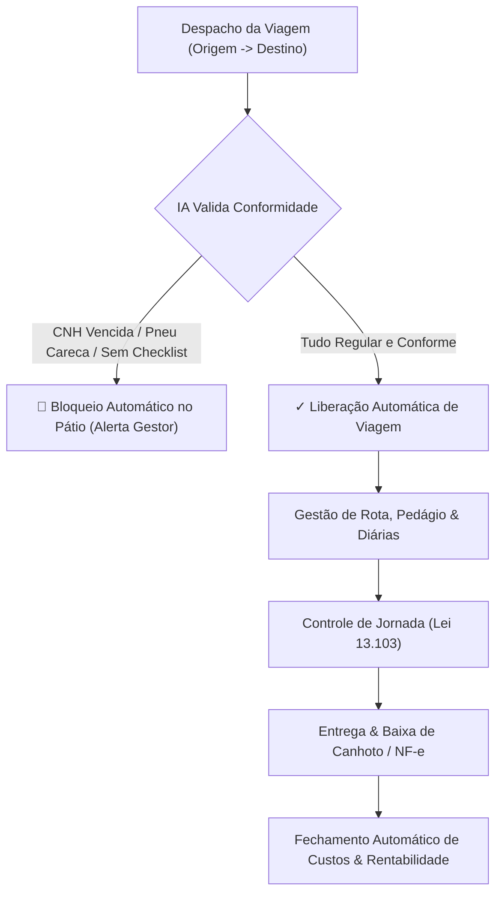

# Geevheit Intelligence 360 — Plano Estratégico de Engenharia para Produção
## "Tranquilidade do Gestor & Operação 98% Autônoma"

**Documento de Engenharia & Roadmap para Produção**  
**Data:** 12/11/2026  
**Status:** Análise Concluída & Roadmap Operacional Definido  
**Referência:** `services/split01.md` | `TASKS.md` | `docs/CONTINUIDADE.md`

---

## 1. Diagnóstico do Estado Atual vs. Operação Real de Transportadora

O sistema possui uma base técnica sólida e modular em Go, PostgreSQL persistente, regras de integridade e um Mission Control web funcional. 

| Módulo / Vertical | Estado Atual | O que a Transportadora Real Exige |
|---|---|---|
| **Identidade & Tenant** | ✅ Concluído (Postgres, RBAC, Sessões) | Pronto para multi-empresas e filiais. |
| **Frota & Hodômetro** | ✅ Concluído (Anti-regressão, Carretas, Eixos) | Necessita de **Acoplamento Dinâmico (Cavalo + Carreta)**. |
| **Abastecimento & NF** | ✅ Concluído (Requisições, Terceiros, Fisco) | Integração com Custo por Km rodado da Viagem. |
| **Pneus & Sulco** | ✅ Concluído (Ciclo de vida, Posições) | Pronto com alertas no Mission Control. |
| **Manutenção & O.S.** | ✅ Concluído (Downtime, Custos, Notas) | Pronto e integrado com o Almoxarifado. |
| **Estoque & Peças** | ✅ Concluído (Pneus, Peças, Cintas, EPIs) | Pronto e com alertas de estoque mínimo. |
| **Financeiro & Caixa** | ✅ Concluído (Contas a pagar, Boletos, Baixa) | Pronto para receber receitas de frete e adiantamentos. |
| **Mission Control** | ✅ Concluído (SignalScanner 24/7) | Pronto para ser a base do **Agente de IA Autônomo**. |
| **Viagens, Fretes & Despacho** | ⚠️ **Pendente (Fase Seguinte)** | **O coração que movimenta a empresa: Saída, Rota, Chegada, Carga, CT-e, MDF-e, CIOT.** |
| **Jornada do Motorista** | ⚠️ **Pendente (Lei 13.103/2015)** | **Controle de 5h30 direção, descansos e diárias (blindagem jurídica).** |
| **Vale-Pedágio Obrigatório** | ⚠️ **Pendente (Lei 10.209/2001)** | **Tags e cartões vinculados à viagem (Sem Parar, Veloe, ConectCar).** |
| **Deploy & Infraestrutura** | ⚠️ **Pendente** | **Docker Compose unificado, Backups automáticos e SSL/HTTPS.** |

---

## 2. Pilares Críticos para o Gestor Dormir Tranquilo ("Operação 98% Autônoma")

Para que uma transportadora com equipe reduzida funcione com 98% de autonomia por IA, o sistema deve resolver 4 dores imediatas:



### Pilar 1: Módulo de Viagens, Fretes & Despacho (`trips`)
- Vínculo ativo: **Cavalo Mecânico + Carreta/Semirreboque + Motorista + Rota**.
- Cadastro da Carga: Cliente, Tipo de mercadoria, Peso (toneladas), Valor da Carga.
- Documentos de Transporte: Chaves do MDF-e, CT-e e número do CIOT (obrigatório ANTT).
- Controle de Valores: Valor Bruto do Frete, Adiantamento para viagem (combustível/alimentação) e Saldo a Pagar na entrega.
- Status do ciclo de vida: `planejada` ➔ `em_carregamento` ➔ `em_viagem` ➔ `descarregando` ➔ `concluida` ➔ `liquidada`.

### Pilar 2: Blindagem Trabalhista — Jornada do Motorista (Lei 13.103/2015)
- O maior risco financeiro de donos de transportadoras no Brasil são ações trabalhistas de motoristas por horas extras e falta de descanso.
- Apontamento simples de jornada:
  - Início de direção, Parada para descanso (mínimo 30 min a cada 5h30), Almoço e Pernoite (descanso diário de 11h).
- A IA calcula automaticamente o tempo de volante e alerta o gestor e o motorista se houver extrapolação do limite legal.

### Pilar 3: Acoplamento Dinâmico de Conjuntos (Cavalo + Carreta)
- Em uma transportadora, um caminhão não anda sempre com a mesma carreta: ele chega no pátio, desengata um baú frigorífico e engata uma graneleira.
- O sistema deve permitir o acoplamento e desacoplamento com 1 clique, transferindo automaticamente a responsabilidade do conjunto.

### Pilar 4: Vale-Pedágio & Despesas de Estrada
- Registro da tag de pedágio (Sem Parar, Veloe, ConectCar, Move Mais) e valor carregado para a viagem (cumprimento da Lei 10.209/2001).
- Comprovantes de despesas de viagem (borracharia, lavador, pequenos reparos) lançados pelo motorista e já conciliados no financeiro.

---

## 3. Arquitetura de Deploy em Produção (Infraestrutura Segura)

Para colocar a aplicação em produção com segurança e facilidade de manutenção:

```
[ Internet / Clientes / Gestor ]
             │
             ▼ HTTPS (Porta 443) / Let's Encrypt
┌────────────────────────────────────────────────────────┐
│  Nginx Reverse Proxy & Static Server (Mission Control)  │
└──────────────────────────┬─────────────────────────────┘
                           │ Proxy Interno (Porta 8080)
                           ▼
┌────────────────────────────────────────────────────────┐
│  Backend API Go Monolith (Geevheit 360 Core)            │
│  - SignalScanner 24/7 (Motor Autônomo)                 │
└──────────────────────────┬─────────────────────────────┘
                           │ Conexão TCP Segura
                           ▼
┌────────────────────────────────────────────────────────┐
│  PostgreSQL 16 Database                                │
│  - Volume Persistente SSD                              │
│  - Cron de Backup Diário Automatizado (pg_dump)         │
└──────────────────────────┘
```

1. **`docker-compose.prod.yml`:**
   - Serviço `postgres`: Banco de dados de produção com volume persistente em disco.
   - Serviço `api`: Backend compilado em Go com migrações automáticas no boot.
   - Serviço `web`: Frontend Mission Control servido via Nginx com proxy reverso.
   - Serviço `backup`: Container utilitário executando backup automático diário às 03:00 com retenção de 30 dias.
2. **Segurança de Acesso:**
   - Variáveis de ambiente sensíveis (`DATABASE_URL`, `AUTH_SECRET`) isoladas em arquivo `.env.production` (fora do versionamento git).
   - Bloqueio de portas do PostgreSQL para a internet (apenas acesso interno na rede do Docker).

---

## 4. Roteiro de Execução Proposto

Propomos organizar a implementação nos seguintes passos objetivos:

- **Etapa A (Imediata):** Implementar o **Módulo de Viagens & Despacho de Cargas** (cadastro de viagens, acoplamento cavalo-carreta-motorista, fretes, adiantamentos e integração no Mission Control).
- **Etapa B:** Implementar o **Controle de Jornada do Motorista & Diárias** (Lei 13.103/2015) integrado aos checklists e alertas da IA.
- **Etapa C:** Montar o **Ambiente de Deploy de Produção** (`docker-compose.prod.yml`, rotina de backup `pg_dump` automatizada, script de deploy com 1 comando).

Este plano garante que o sistema seja o coração operacional da transportadora, entregando a autonomia que o cliente precisa para operar com equipe enxuta.

